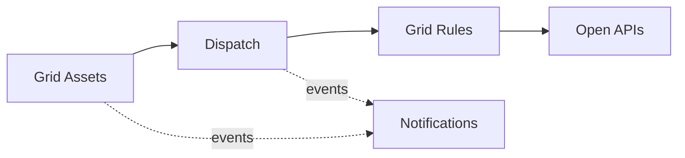

# Domain Model and Bounded Contexts

Ubiquitous language and context design (view VP-4). Domain-standard concepts are mapped
normatively in `../domain/domain-standards.md` (CR-5).

## Ubiquitous language (selected terms)

| Term | Meaning |
|---|---|
| **Grid asset** | A substation, feeder, transformer, solar plant or battery in the registry |
| **Dispatch capacity** | An asset's guarded available capacity, in MW units |
| **Dispatch order** | One dispatch draw against an asset's capacity, by source type |
| **Grid rule** | A decision rule binding a zone type to load and outage envelopes |
| **Meter** | A metering point in the catalogue (smart, industrial, legacy) |
| **Grid anomaly score** | A transparent 0-100 risk score from grid deviation signals |

## Bounded contexts and invariants

### Grid Assets — `grid-asset-service`
Registry of grid assets (CIM concept-level shapes). Lifecycle: `IN_SERVICE` → transitions
maintain, retire. Grid operational data is critical-infrastructure information: it is treated as sensitive operational data (IEC 62443 zones/conduits posture), never mixed with customer personal data, and all values here are synthetic.

### Dispatch — `dispatch-service`
Guarded dispatch capacity per asset and the dispatch orders against it. **Invariant (ADR-0004): dispatched energy against an asset's available capacity never exceeds that capacity — a dispatch order that would overrun it is rejected (422) and records nothing.** Consumption records are
append-only evidence; a rejected operation records nothing.

### Grid Rules — `grid-rules-service`
Decision rules binding zone types to load and outage envelopes. Only ACTIVE rules decide; evaluation order is by priority; every decision
is ALLOWED / DEGRADED / DENIED with the matched rule and a human-readable reason.

### Meters — `meter-catalog-service`
Metering point catalogue.

### Notifications — `notification-service`
Delivery trail for audit; recipients are never logged.

## Context map

